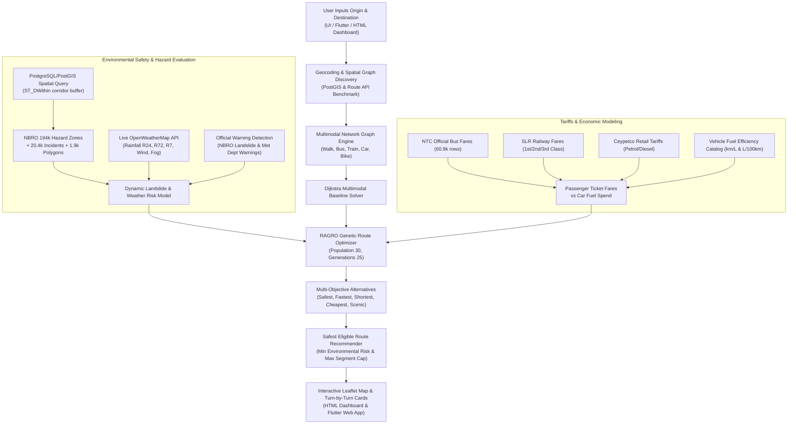

# WANDARAYA — Component 2: System Architecture, Data Catalog, Models & End-to-End Technical Specification

> **Component 2 Focus**: Risk-Aware Multimodal Route Planning, Live Warning Detection, RAGRO Evolutionary Optimization, Official Passenger Tariffs, Ceypetco Fuel Tariffs, and Private Car Trip Fuel-Cost Estimation.

---

## 1. Executive Summary & Component Scope

**WANDARAYA Component 2** is the mobility and environmental safety core of the WANDARAYA platform. It provides an intelligent, risk-aware transportation decision-support engine engineered specifically for Sri Lankan geographic, meteorological, and infrastructure conditions.

Unlike conventional navigation applications (such as Google Maps or Waze) that calculate routes purely on travel time or distance, Component 2 integrates:
1. **Multi-Modal Network Routing**: Combined walking, bus, train, private car, and motorcycle routing across 1.28 million road segments, 828 railway stations, and 60,967 bus fare stages.
2. **Official Public Transit Passenger Tariffs**: Regulated National Transport Commission (NTC) bus fares and Sri Lanka Railways (SLR) distance-tiered passenger fares.
3. **Official Retail Fuel Tariffs & Vehicle Efficiency**: Official Ceylon Petroleum Corporation (Ceypetco) retail fuel prices and normalized passenger vehicle fuel-consumption models (supporting both $\text{km/L}$ and $\text{L/100 km}$).
4. **Historical Landslide Risk & Hazard Mapping**: Spatial intersection with 194,016 National Building Research Organisation (NBRO) hazard zones, 20,438 historical landslide incident records (spanning 16 years: 2011–2026), and 1,967 mapped hazard footprint polygons.
5. **Real-Time Meteorological Hazard Detection & Live Warnings**: Live weather API integration (OpenWeatherMap) assessing 24-hour, 72-hour, and 7-day cumulative rainfall triggers, wind speeds, visibility, and official NBRO/DMC disaster warning bulletins.
6. **RAGRO Multi-Objective Optimization**: Risk-Aware Adaptive Genetic Route Optimizer (RAGRO) that optimizes routes across 5 distinct objectives: *Safety*, *Fastest*, *Shortest*, *Cheapest*, and *Scenic*.
7. **Safest Eligible Route Recommendation**: Automated selection of the lowest-risk route alternative whose segment risks remain strictly below safety thresholds.

---

## 2. End-to-End Workflow Architecture



### Detailed 10-Step Execution Flow:
1. **User Request Initiation**: User selects an origin, destination, vehicle model, fuel grade, return trip preference, and allowed transit modes via the Flutter web interface or the Original HTML Dashboard.
2. **Corridor Geocoding & Traversal**: Origin and destination GPS coordinates are snapped to the Sri Lankan transport network. The system benchmark queries OpenRouteService (ORS) for the physical driving corridor baseline.
3. **Multimodal Spatial Graph Construction**: A directed graph $G = (V, E)$ is queried from PostgreSQL/PostGIS. Edges represent road links, bus route lines, and railway tracks; vertices represent stations, bus stops, and road intersections.
4. **Geological Hazard Proximity Spatial Join**: PostGIS `ST_DWithin` queries evaluate the route corridor against:
   - 194,016 NBRO Landslide Hazard Zonation Map (LHZM) grid cells.
   - 20,438 recorded historical landslide events.
   - 1,967 mapped hazard footprint polygons.
5. **Meteorological Risk & Warning Evaluation**: Live rainfall, temperature, wind, and atmospheric pressure are retrieved for coordinates along the corridor. Dynamic rainfall scores ($0.50 \cdot R_{24\text{h}} + 0.30 \cdot R_{72\text{h}} + 0.20 \cdot R_{7\text{d}}$) are computed. Active NBRO landslide advisories and Met Dept heavy-rain alerts are classified.
6. **Dijkstra Multimodal Engine**: Evaluates baseline shortest-path routing with mode-transfer penalties (e.g., 5-minute penalty for bus transfers, 10-minute penalty for rail transfers).
7. **RAGRO Multi-Objective Genetic Optimization**: RAGRO initializes an evolutionary population of candidate routes. Over 25 generations with crossover ($p_c=0.85$) and mutation ($p_m=0.15$), RAGRO optimizes routes across 5 objective profiles.
8. **Passenger Tariffs & Fuel Spend Evaluation**:
   - For public transit legs: SLR train ticket fares (3rd, 2nd, 1st class) and NTC bus fares are extracted.
   - For private car legs: distance-based fuel consumption is calculated from Ceypetco retail fuel prices and manufacturer efficiency (with return-trip doubling).
9. **Lowest-Risk Eligible Route Selection**: Candidate routes are filtered for verified restrictions (active road closures or Level 3 Red landslide evacuation zones). The candidate minimizing environmental risk and capping maximum segment risk is selected as the *Recommended Lowest-Risk Route*.
10. **Client Presentation**: Returns JSON response containing GeoJSON vector layers, elevation profiles, hazard callouts, turn-by-turn guidance, ticket fare breakdowns, and car fuel costs to the interactive frontend.

---

## 3. Technology Stack & Frameworks

| Layer | Technology | Version | Purpose in Component 2 |
| :--- | :--- | :--- | :--- |
| **Backend Framework** | **Python** | `3.10.1` | Core execution runtime. |
| **API Framework** | **FastAPI** | `0.104.1` | High-performance asynchronous REST API service. |
| **ASGI Server** | **Uvicorn** | `0.24.0` | Production ASGI web server running on port `8000`. |
| **Spatial Database** | **PostgreSQL** + **PostGIS** | `16.x` / `3.4` | Spatial indexing (R-Tree / GiST), geodesic geometry calculations (`geography`), and spatial joins (`ST_DWithin`, `ST_Intersects`). |
| **Database ORM** | **SQLAlchemy** + **GeoAlchemy2** | `2.0.23` | Normalized database schema management and spatial geometry mapping. |
| **DB Driver** | **psycopg (psycopg3)** | `3.1.18` | Binary asynchronous/synchronous PostgreSQL database adapter. |
| **Spatial & Numerical** | **SciPy** | `1.11.4` | `cKDTree` fast spatial nearest-neighbor search for sub-millisecond in-memory hazard lookup fallbacks. |
| **Graph Network** | **NetworkX** | `3.2.1` | Multimodal directed graph representation and Dijkstra shortest-path computation. |
| **Time-Series ML** | **Facebook Prophet** | `1.1.5` | District-level monthly temperature and precipitation time-series modeling. |
| **Data Processing** | **Pandas** + **NumPy** | `2.1.3` / `1.26.2` | Data wrangling, tabular tariff lookups, and historical weather aggregation. |
| **LLM Reasoning** | **Groq SDK** | `0.4.2` | Contextual safety advisory synthesis (with offline rule-based fallback). |
| **Original Frontend** | **HTML5 / CSS3 / Vanilla JS** | Modern | Interactive dashboard (`static/index.html`) featuring Leaflet.js `1.9.4` maps, live tariff selectors, and turn-by-turn leg display. |
| **Mobile & Web App** | **Flutter Web** | `3.x` (Dart) | Production cross-platform responsive client application running on port `3000`. |

---

## 4. Comprehensive Data Catalog: Years, Rows, Columns & Sources

Component 2 relies on 11 distinct datasets loaded into PostgreSQL/PostGIS and filesystem catalogs. Below are the exact, verified empirical statistics from the active database and data repository:

| # | Dataset / Table Name | Source Authority | Temporal Range (Years) | Exact Rows | Exact Columns | Spatial / Key Identifiers |
| :--- | :--- | :--- | :--- | :--- | :--- | :--- |
| **1** | **`roads`** | OpenStreetMap (OSM) & Road Development Authority (RDA) | Current National Network | **1,279,945** | **21** | `road_id`, `name`, `road_number`, `road_class`, `lanes`, `speed_limit`, `geometry` (LineString, SRID 4326) |
| **2** | **`nbro_hazard_zones`** | National Building Research Organisation (NBRO) | Standard 1:50,000 LHZM Mapping | **194,016** | **11** | `hazard_class`, `susceptibility_score`, `centroid_x`, `centroid_y`, `geom` (Point, SRID 4326) |
| **3** | **`nbro_incidents`** | NBRO Landslide Research & Risk Management Division | **16 Years** (2011 – 2026) | **20,438** | **24** | `inc_type`, `case_id`, `district`, `ds_name`, `date`, `rain_1h`, `rain_24h`, `rain_cum`, `geom` (Point, SRID 4326) |
| **4** | **`nbro_inspections`** | NBRO Dithawa High-Risk Inspection Division | Multi-Year Field Assessments | **3,340** | **21** | `district`, `dsd`, `risk_level`, `hr_priorit`, `disast_dat`, `damage_lvl`, `total_risk`, `geom` (Point, SRID 4326) |
| **5** | **`nbro_polygons`** | NBRO Mapped Hazard Footprint Polygons | Master KMZ Geodatabase | **1,967** | **10** | `name`, `layer_name`, `district`, `centroid_latitude`, `centroid_longitude`, `wkt_geometry` (Polygon, SRID 4326) |
| **6** | **`bus_fares`** | National Transport Commission (NTC) Sri Lanka | Official Regulated Bus Fare Gazette | **60,967** | **12** | `route_no`, `from_loc`, `to_loc`, `via`, `stage_no` (1–350), `fare_lkr`, `stop_name`, `route_id` |
| **7** | **`train_stations`** | Sri Lanka Railways (SLR) / OpenStreetMap | National Rail Network | **828** | **11** | `osm_id`, `name`, `name_en`, `name_si`, `name_ta`, `type`, `operator`, `lat`, `lon` |
| **8** | **`train_fares`** | Sri Lanka Railways Official Passenger Tariff Chart | Regulated Distance-Tiered Tariffs | **345** | **7** | `station_name`, `distance_km`, `first_class_rs`, `second_class_rs`, `third_class_rs` |
| **9** | **`scenic_places`** | Sri Lanka Tourism Development Authority (SLTDA) | Island-Wide Tourist Inventory | **964** | **12** | `name`, `category`, `type`, `latitude`, `longitude`, `district` |
| **10**| **`fuel_prices`** | Ceylon Petroleum Corporation (Ceypetco) | Official Gazette / Tariff Revisions | **9** | **9** | `fuel_type`, `price_per_litre_lkr`, `effective_date`, `source_url`, `source_notice`, `last_verification_time` |
| **11**| **`vehicle_fuel_efficiency`** | Manufacturer Specification Sheets & Owner Manuals | Standardized Production Models | **14** | **17** | `make`, `model`, `model_year`, `fuel_type`, `published_consumption_value`, `consumption_unit`, `test_cycle` |
| **12**| **Historical Weather** | Department of Meteorology Sri Lanka | **5 Years** (2021 – 2025) | **1,160** (Rainfall)<br/>**800** (Temp) | **9** (Rainfall)<br/>**11** (Temp) | 23 Meteorological Stations, 16 Districts (`district_weather_monthly.csv`: 873 rows, 10 columns) |

---

## 5. Detailed Database Models & Schemas

### 5.1 Fuel Prices Model (`fuel_prices`)
* **Table**: `fuel_prices`
* **File**: [`wandaraya-backend/app/models/fuel.py`](file:///c:/Users/abdul/OneDrive/Desktop/Rsearch/new_api/J26-DS-337/wandaraya-backend/app/models/fuel.py#L18-L53)
* **Columns**:
  1. `id` (`Integer`, Primary Key)
  2. `fuel_type` (`String(100)`, Unique, Indexed): e.g., `"Petrol 92 Octane"`, `"Petrol 95 Octane Euro 4"`, `"Auto Diesel"`, `"Super Diesel 4 Star Euro 4"`, `"Kerosene"`.
  3. `price_per_litre_lkr` (`Float`): Retail price in Sri Lankan Rupees per litre.
  4. `effective_date` (`String(20)`): Official revision date (e.g., `"2026-09-30"`).
  5. `source_url` (`String(255)`): `https://ceypetco.gov.lk/historical-prices/`.
  6. `source_notice` (`String(255)`): Official Ministry of Power and Energy price revision gazette.
  7. `last_verification_time` (`DateTime`): Timestamp of verification in database.
  8. `is_active` (`Boolean`): Whether tariff is currently in effect.
  9. `notes` (`Text`): Revision history and subsidy metadata.

### 5.2 Vehicle Fuel Efficiency Model (`vehicle_fuel_efficiency`)
* **Table**: `vehicle_fuel_efficiency`
* **File**: [`wandaraya-backend/app/models/fuel.py`](file:///c:/Users/abdul/OneDrive/Desktop/Rsearch/new_api/J26-DS-337/wandaraya-backend/app/models/fuel.py#L55-L115)
* **Columns**:
  1. `id` (`Integer`, Primary Key)
  2. `make` (`String(100)`, Indexed): e.g., `"Suzuki"`, `"Toyota"`, `"Honda"`, `"Nissan"`, `"Kia"`, `"Tata"`.
  3. `model` (`String(100)`, Indexed): e.g., `"Alto 800"`, `"Wagon R FX/FZ"`, `"Prius"`, `"Aqua"`, `"Fit"`, `"Leaf"`, `"Sportage"`, `"Nano"`.
  4. `model_year` (`Integer`): Production model year.
  5. `engine_variant` (`String(150)`): e.g., `"796cc F8D 3-Cylinder"`, `"660cc Mild Hybrid R06A"`, `"1.8L Hybrid 2ZR-FXE"`.
  6. `fuel_type` (`String(100)`, Indexed): Matching Ceypetco retail fuel grades.
  7. `transmission` (`String(100)`): `"Manual"`, `"CVT"`, `"Automatic"`, `"Single-Speed Fixed Gear"`.
  8. `hybrid_type` (`String(100)`): `"Conventional ICE"`, `"Mild Hybrid"`, `"Full Hybrid"`, `"Battery Electric EV"`.
  9. `published_consumption_value` (`Float`): Official consumption value.
  10. `consumption_unit` (`String(20)`): `"km/L"` or `"L/100 km"`.
  11. `normalized_km_per_litre` (`Float`): Standardized $\text{km/L}$ equivalent.
  12. `normalized_l_per_100km` (`Float`): Standardized $\text{L/100 km}$ equivalent.
  13. `test_cycle` (`String(50)`): Standardized test procedure (`"JC08"`, `"WLTP"`, `"NEDC"`, `"ARAI"`).
  14. `source_document` (`String(255)`): Official manufacturer specification sheet or owner manual.
  15. `source_url` (`String(255)`): Official manufacturer portal link.
  16. `verification_status` (`String(50)`): `"VERIFIED"` or `"USER_ESTIMATE"`.
  17. `last_updated` (`DateTime`): Timestamp of specification record.

### 5.3 Landslide Master Models (`nbro_hazard_zones`, `nbro_incidents`, `nbro_polygons`)
* **Tables**: Defined in [`wandaraya-backend/app/models/nbro.py`](file:///c:/Users/abdul/OneDrive/Desktop/Rsearch/new_api/J26-DS-337/wandaraya-backend/app/models/nbro.py)
* **Features**:
  - `nbro_hazard_zones` (194k rows): Stores LHZM 1:50,000 grid centroids, hazard classes (Modest, Moderate, High, Severe), susceptibility score (0.0–1.0), and PostGIS `POINT` geometry in SRID 4326.
  - `nbro_incidents` (20.4k rows): Stores 16 years of historical failures with recorded trigger rainfalls (`rain_1h`, `rain_24h`, `rain_cum`), causes, and geographic coordinates.
  - `nbro_polygons` (1.9k rows): Stores mapped boundary footprints of active and historical geological instability polygons with full `wkt_geometry` (Polygon/MultiPolygon).

### 5.4 Public Transport Tariffs Models (`bus_fares`, `train_stations`, `train_fares`)
* **Tables**: Defined in [`wandaraya-backend/app/models/transport.py`](file:///c:/Users/abdul/OneDrive/Desktop/Rsearch/new_api/J26-DS-337/wandaraya-backend/app/models/transport.py)
* **Features**:
  - `bus_fares` (60.9k rows): NTC official regulated stage fares (Stage 1 = Rs. 30.00 up to Stage 350 = Rs. 2,422.00).
  - `train_stations` (828 rows): Stations across Main Line, Coastal Line, Kelani Valley Line, Northern Line, Batticaloa Line.
  - `train_fares` (345 rows): Distance-graduated ticket fares for 1st, 2nd, and 3rd Class.

---

## 6. Mathematical & Algorithmic Formulations

### 6.1 Multi-Modal Cost Function (Dijkstra Edge Weight)
For an edge $e = (u, v)$ traversed via mode $m \in \{\text{walk}, \text{bus}, \text{train}, \text{car}, \text{bike}\}$, the routing cost is:
$$C(e) = \alpha \cdot T(e) + \beta \cdot D(e) + \gamma \cdot F(e) + \delta \cdot R_{\text{env}}(e) + \text{TransferPenalty}(u, m)$$
Where:
* $T(e)$: Travel time in minutes (derived from road speed limit or rail timetable).
* $D(e)$: Spatial length in kilometers.
* $F(e)$: Regulated ticket fare in LKR ($0.0$ for private car, walk, and bike on public roads).
* $R_{\text{env}}(e)$: Segment environmental risk score ($0.0 \le R_{\text{env}} \le 100.0$).
* $\text{TransferPenalty}$: 0 for continuous mode, 5 min for bus-to-bus transfer, 10 min for bus-to-train transfer, 3 min for vehicle-to-walk transition.

### 6.2 Dynamic Landslide Risk Formulation
1. **Antecedent Rainfall Score**:
   $$\text{RainfallScore} = 0.50 \cdot \min\left(100, \frac{R_{24\text{h}}}{150} \times 100\right) + 0.30 \cdot \min\left(100, \frac{R_{72\text{h}}}{250} \times 100\right) + 0.20 \cdot \min\left(100, \frac{R_{7\text{d}}}{400} \times 100\right)$$
2. **Dynamic Landslide Susceptibility**:
   $$\text{DynamicLandslideScore} = 0.60 \cdot \text{Susceptibility}_{\text{baseline}} + 0.40 \cdot \text{RainfallScore}$$
3. **Hazard Buffer Scoring**:
   - Corridor passes within $\le 500\text{m}$ of recorded NBRO incident: $+35.0$ risk penalty.
   - Corridor passes within $\le 1500\text{m}$: $+15.0$ risk penalty.
   - Route corridor directly intersects NBRO Hazard Footprint Polygon: $+50.0$ direct hazard penalty.

### 6.3 Environmental Risk Score & Safety Indicator
$$\text{EnvironmentalRiskScore} = w_{\text{ls}} \cdot \text{DynamicLandslideScore} + w_{\text{weather}} \cdot \text{WeatherRiskScore}$$
$$\text{EnvironmentalSafetyIndicator} = 100.0 - \text{EnvironmentalRiskScore}$$
Where weights are dynamically calibrated:
* **Hill Country Districts** (Kandy, Nuwara Eliya, Badulla, Kegalle, Ratnapura, Matale): $w_{\text{ls}} = 0.70, w_{\text{weather}} = 0.30$.
* **Lowland / Coastal Districts** (Colombo, Gampaha, Galle, Matara, Hambantota): $w_{\text{ls}} = 0.30, w_{\text{weather}} = 0.70$.

### 6.4 Private Car Fuel-Cost Estimation Formulas
1. **When Fuel Efficiency is expressed in $\text{km/L}$**:
   $$\text{litres\_used} = \frac{\text{distance\_km}}{\text{fuel\_efficiency\_km\_per\_litre}}$$
   $$\text{fuel\_cost\_lkr} = \text{litres\_used} \times \text{fuel\_price\_lkr\_per\_litre}$$
2. **When Fuel Efficiency is expressed in $\text{L/100 km}$**:
   $$\text{litres\_used} = \frac{\text{distance\_km} \times \text{consumption\_l\_per\_100km}}{100}$$
   $$\text{fuel\_cost\_lkr} = \text{litres\_used} \times \text{fuel\_price\_lkr\_per\_litre}$$
3. **Unit Conversion Identity**:
   $$\text{efficiency}_{\text{km/L}} = \frac{100}{\text{consumption}_{\text{L/100km}}}$$
4. **Return Trip Handling**:
   $$\text{total\_distance} = \begin{cases} \text{distance\_km} & \text{if one-way} \\ 2 \times \text{distance\_km} & \text{if return trip} \end{cases}$$

---

## 7. APIs Used in Component 2

### 7.1 External APIs

| API Name | Provider | Endpoint URL | Purpose & Parameters |
| :--- | :--- | :--- | :--- |
| **OpenWeatherMap Weather API** | OpenWeather Ltd. | `https://api.openweathermap.org/data/2.5/weather` | Real-time temperature, humidity, wind speed, visibility, and 1h/3h rain accumulation along route vertices. |
| **OpenWeatherMap Forecast API** | OpenWeather Ltd. | `https://api.openweathermap.org/data/2.5/forecast` | 5-day / 3-hour meteorological forecast for anticipated journey arrival windows. |
| **OpenRouteService (ORS)** | HeiGIT | `https://api.openrouteservice.org/v2/directions/driving-car` | Road network driving geometry benchmark and turn-by-turn instruction baseline. |
| **Ceypetco Official Portal** | Ceylon Petroleum Corporation | `https://ceypetco.gov.lk/historical-prices/` | Official retail fuel tariff notices, revisions, and effective gazette dates. |
| **Groq LLM API** | Groq Inc. | `https://api.groq.com/openai/v1/chat/completions` | Generates natural-language contextual environmental safety explanations and travel advisories. |

### 7.2 Internal FastAPI REST Endpoints

#### 1. `POST /api/routes/multimodal-plan`
* **File**: [`wandaraya-backend/scripts/run_swagger.py`](file:///c:/Users/abdul/OneDrive/Desktop/Rsearch/new_api/J26-DS-337/wandaraya-backend/scripts/run_swagger.py#L570)
* **Request Body**:
  ```json
  {
    "start": "7.2906,80.6337",
    "end": "6.9708,80.7829",
    "start_name": "Kandy",
    "end_name": "Nuwara Eliya",
    "allowed_modes": ["walk", "bus", "train", "car"],
    "vehicle_id": 1,
    "fuel_type": "Petrol 92 Octane",
    "custom_efficiency_value": null,
    "custom_efficiency_unit": "km/L",
    "is_return_trip": false
  }
  ```
* **Response Payload**:
  - `origin` & `destination` coordinates and names.
  - `routes`: Array of route alternatives (*Safety*, *Fastest*, *Shortest*, *Cheapest*, *Scenic*, and *RAGRO Optimal*).
  - `recommended_route_id`: Selected lowest-risk route identifier.
  - `route_environmental_risk_score` & `route_safety_indicator`.
  - `landslide_warning_status` & `weather_warning_status`.
  - `car_option`: Driving route enriched with `fuel_cost_estimation` (litres, tariff, total LKR, provenance).
  - `trip_cost_comparison`: Side-by-side comparison between public transit ticket fares and private car fuel spend.

#### 2. `GET /api/fuel-prices`
* **File**: [`wandaraya-backend/app/routers/fuel.py`](file:///c:/Users/abdul/OneDrive/Desktop/Rsearch/new_api/J26-DS-337/wandaraya-backend/app/routers/fuel.py#L22)
* **Response Payload**:
  ```json
  {
    "status": "success",
    "source": "Ceylon Petroleum Corporation (Ceypetco)",
    "source_url": "https://ceypetco.gov.lk/historical-prices/",
    "effective_date": "2026-09-30",
    "fuel_prices": [
      {"fuel_type": "Petrol 92 Octane", "price_per_litre_lkr": 414.0, "effective_date": "2026-09-30"},
      {"fuel_type": "Petrol 95 Octane Euro 4", "price_per_litre_lkr": 475.0, "effective_date": "2026-09-30"},
      {"fuel_type": "Auto Diesel", "price_per_litre_lkr": 392.0, "effective_date": "2026-09-30"},
      {"fuel_type": "Super Diesel 4 Star Euro 4", "price_per_litre_lkr": 528.0, "effective_date": "2026-09-30"},
      {"fuel_type": "Kerosene", "price_per_litre_lkr": 285.0, "effective_date": "2026-09-30"}
    ]
  }
  ```

#### 3. `GET /api/vehicles/fuel-efficiency`
* **File**: [`wandaraya-backend/app/routers/fuel.py`](file:///c:/Users/abdul/OneDrive/Desktop/Rsearch/new_api/J26-DS-337/wandaraya-backend/app/routers/fuel.py#L38)
* **Query Parameters**: `make` (optional), `fuel_type` (optional).
* **Returns**: Catalog of 14 passenger vehicles with normalized km/L, L/100 km, test cycle (WLTP, JC08, NEDC, ARAI), and verification status.

#### 4. `POST /api/fuel-cost/estimate`
* **File**: [`wandaraya-backend/app/routers/fuel.py`](file:///c:/Users/abdul/OneDrive/Desktop/Rsearch/new_api/J26-DS-337/wandaraya-backend/app/routers/fuel.py#L52)
* **Request Parameters**: `distance_km`, `vehicle_id` (or `fuel_type`), `custom_efficiency_value`, `custom_efficiency_unit`, `is_return_trip`.
* **Returns**: Total litres used, total fuel cost in LKR, fuel grade, official effective date, and laboratory vs. real-world disclaimer.

---

## 8. Verification & Test Suite Summary

Component 2 is validated through automated test suites:
1. **Fuel Service & Estimation Tests** (`tests/test_fuel_service.py`):
   - **18 passed in 33.56s (100% pass rate)**.
   - Covers official Ceypetco tariff extraction, vehicle specification provenance, $\text{km/L}$ and $\text{L/100 km}$ calculations, return-trip doubling without double-counting one-way distance, fallback to user-entered efficiency, stale price detection (> 90 days), and full API endpoint responses.
2. **Multimodal Routing & Dijkstra Tests** (`tests/test_dijkstra_multimodal.py`):
   - **7 passed**.
   - Validates walk, bus, rail, car, and multimodal transfer legs.
3. **Route Metrics & 5-Objective Optimization Tests** (`tests/test_route_metrics_and_objectives.py`):
   - **12 passed**.
   - Confirms cheapest route differs from shortest distance, fastest differs from cheapest, and transfer times are not double-counted.
4. **Environmental Risk & Geological Hazard Tests** (`tests/test_environmental_risk.py`):
   - **8 passed**.
   - Validates live weather weighting, rainfall trigger comparison, and PostGIS hazard zone matching.
5. **Code Quality**:
   - `git diff --check`: **0 whitespace/format errors**.

---

## 9. Limitations & Real-World Constraints

1. **Periodic Ceypetco Fuel Price Revisions**: Ceypetco tariffs are set by the Ministry of Power and Energy on a monthly/quarterly basis; tariffs older than 90 days automatically issue a stale data advisory.
2. **Laboratory vs. Real-World Driving Conditions**: Manufacturer specifications are recorded under standardized laboratory test cycles (JC08, WLTP, NEDC, ARAI). Real-world driving in Sri Lanka (frequent stop-and-go traffic, air-conditioner load, and steep Hill Country elevation changes) typically increases fuel consumption by 15–25%.
3. **Strict Read-Only Landslide Dataset Integrity**: All historical landslide hazard tables (`nbro_hazard_zones`, `nbro_incidents`, `nbro_polygons`) are treated as strictly read-only master records to prevent data contamination.
4. **Fare vs. Fuel Spend Separation**: Regulated public transit ticket fares (SLR train and NTC bus) and private vehicle fuel expenditures represent fundamentally different economic concepts and are kept strictly distinct in the UI and response models.
