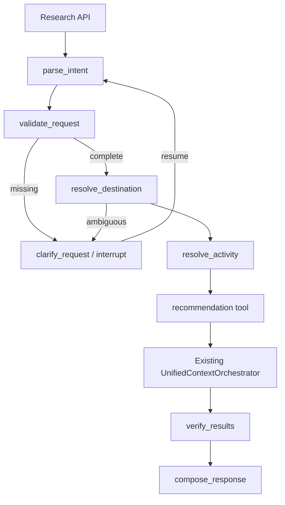

# Stage 12.6 LangGraph Architecture

LangGraph controls bounded workflow transitions and checkpoint/resume. LangChain Core supplies Pydantic-backed `StructuredTool` wrappers and structured-message abstractions. The existing Stage 12.5 orchestrator alone performs semantic retrieval, evidence collection, numerical scoring, stable sorting, and explanations. No LLM can edit a score, rank, feature flag, database query, or production order.

Deterministic intent parsing is the default. Optional structured LLM extraction uses `ChatOpenAI` against the already approved Groq-compatible endpoint only when its flag and key are configured; failure falls back to deterministic extraction. External tracing is not enabled.
