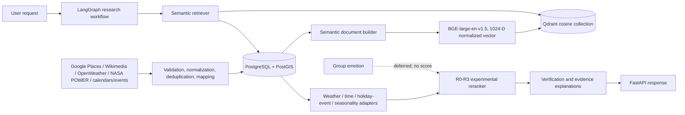
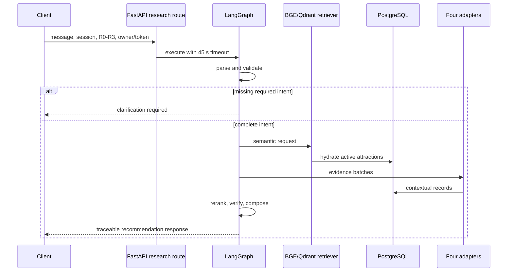
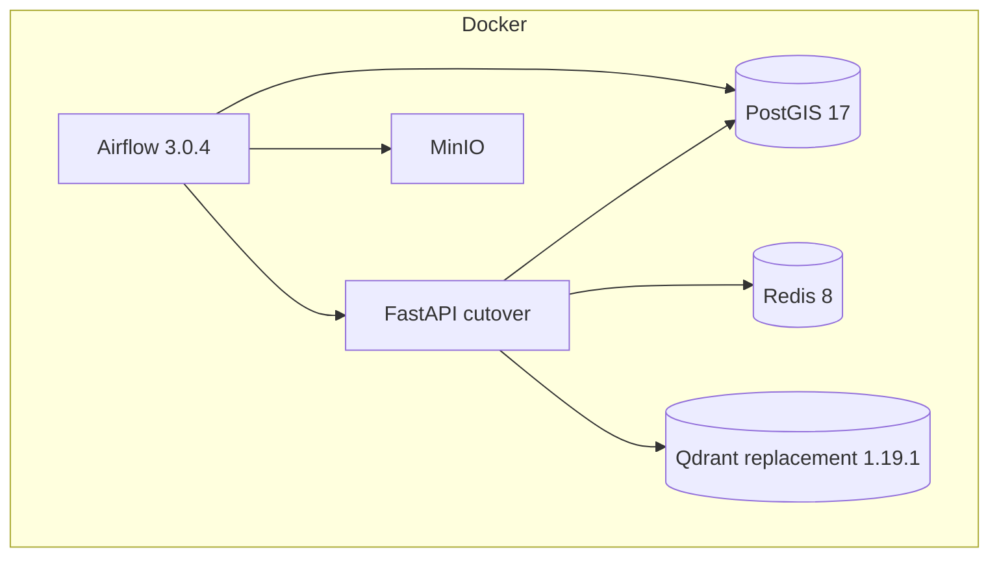
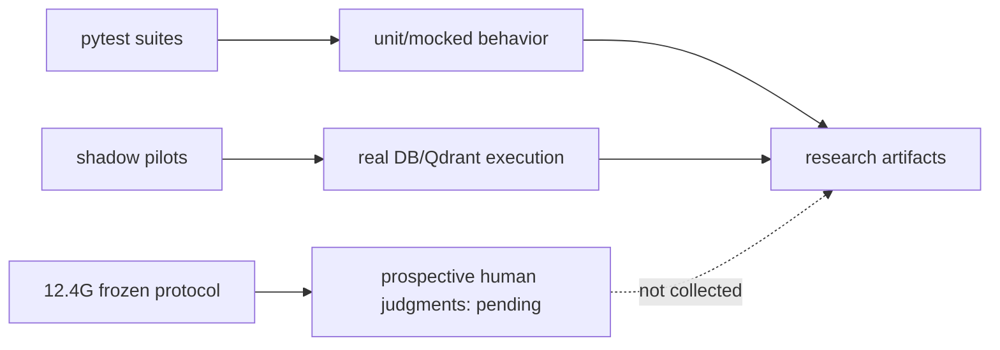

# Complete System Architecture

## Implemented architecture

Evidence: `app/main.py`, `app/knowledge_base/pipelines/attraction_ingestion_pipeline.py`, `app/recommendation/unified_context/orchestrator.py:47-128`, and `app/agents/recommendation_graph/builder.py:8-27` (A).

## Request sequence

## Data and deployment

The active FastAPI environment points to `http://qdrant-production-replacement:6333` and uses `sri_lanka_attractions_staging` (B). `docker-compose.yml` defines both legacy and replacement Qdrant services; service existence does not prove successful scheduled executions.

## Database interaction and evaluation

Production routing remains separated by false feature flags. The frontend repository was not present, so UI integration is `NOT_VERIFIED`.

