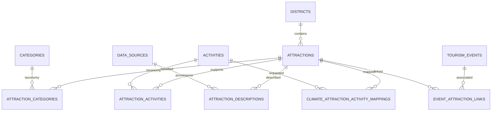

# Tourism Knowledge Base

The knowledge base is hybrid: PostgreSQL/PostGIS is the canonical structured store and Qdrant is the semantic index. At audit time PostgreSQL had 6,120 active attractions, 25 districts, 18 categories and 50 activities; active Qdrant had 6,120 points (B).

Identity is the attraction row; category is a descriptive class; activity is something a visitor can do; district is administrative/geospatial location; climate mapping connects attraction/activity to historical evidence; context evidence is a dated, scored observation used only during reranking.

The ingestion flow is Google details → normalization → validation → district resolution → duplicate detection → relational upsert → Wikipedia/Wikivoyage enrichment → category/activity mapping → semantic document → normalized BGE vector → Qdrant upsert. Evidence: `app/knowledge_base/pipelines/attraction_ingestion_pipeline.py` (A).

The semantic document contains attraction name, de-duplicated location, categories, activities, Wikipedia description and Wikivoyage travel context (`document_builder.py:25-185`). Qdrant payload holds attraction ID, name, city, district, province, categories and activities. PostgreSQL hydration rechecks `is_active=True`, preventing stale vectors from directly becoming API candidates.

PostGIS boundaries support district resolution. Foreign keys and unique joins protect taxonomy and mapping identity. Exact schema is spread across `app/models` and Alembic migrations; live `information_schema` inspection confirmed the current tables (B). No sensitive example values are included.

## Verified schema highlights

| Table | Important columns/constraints | Principal consumers |
|---|---|---|
| `attractions` | integer PK; unique `slug` and `google_place_id`; district FK/index; name/address/city/lat/lon; JSON location/hours/tags/months; rating/reviews; active index; sync timestamps | KB APIs, retrieval hydration, all context adapters |
| `districts` | unique name, province, coordinates/elevation, non-null PostGIS `MULTIPOLYGON` SRID 4326 with spatial index | district resolver, weather/climate routing |
| `categories`, `activities` | unique name, description, active flag | semantic documents and mappings |
| join tables | attraction/category and attraction/activity FKs with unique pair constraints; primary/confidence/suitability fields | document builder, activity resolution |
| `tourism_events` | source FK + source-event identity, dated/location/status/provenance/confidence fields | event context |
| `event_attraction_links` | event/attraction FKs, relationship, evidence and verification | verified-event eligibility |
| `climate_daily_observations` | dataset/grid/date keys, rain/temp/humidity/wind/solar, quality and source hash | aggregation pipeline |
| climate mappings/profiles | attraction/activity/dataset/month identity, evidence/mapping confidence and derived scores | seasonality adapter |
| weather readings/forecasts/model runs | district/time/target/prediction/run approval metadata | weather context and source selection |

Primary evidence: `app/models/attraction.py:7-33`, `district.py:7-18`, taxonomy/join models, `holiday_event.py:17-118`, `climate.py:16+`, and current migrations. The audit uses model-level summaries here; `information_schema` remains the authoritative deployed schema.

Operational gaps: no verified automated Qdrant backup/restore procedure, no transactional two-phase commit across PostgreSQL/Qdrant, and deletion synchronization was not proven. Recovery should rebuild vectors from canonical PostgreSQL with the same embedding model and collection dimension, but the audit did not execute a rebuild.

