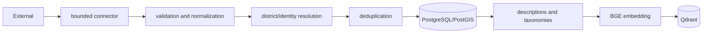

# Data Sources and Ingestion

| Source | Data/use | Method/frequency | Status and limitation |
|---|---|---|---|
| Google Places API (New) | identity, coordinates, ratings, hours, types, photos | connector; KB discovery/refresh DAGs | Implemented; paid/keyed; API terms not audited |
| Wikipedia | encyclopedic description | Wikimedia API enrichment | Implemented with pacing/retries |
| Wikivoyage | travel context | Wikimedia API enrichment | Implemented with pacing/retries |
| OpenWeatherMap | short-range weather | live API; weather DAG configured every 3 h | Implemented; provider availability/key required |
| NASA POWER | historical rainfall, temperature, humidity, solar | acquisition and climate pipeline | Implemented; 0.5° grid is not attraction microclimate |
| calendar-sri-lanka | holiday/Poya dates | annual DAG `15 0 1 1 *` | Implemented source connector |
| LankaEvents | event candidates | daily DAG `30 0 * * *` | Implemented; only verified events score |
| OpenRouteService | route geometry/distance | on-demand API | Implemented outside recommendation ranking core |
| SLTDA artifacts | governance/reconciliation inputs | repository artifacts/scripts | Partial; direct current production feed not proven |
| TripAdvisor | proposed/reference source | none found | NOT_IMPLEMENTED/NOT_VERIFIED |
| Sri Lanka Railways | transport domain data | no verified direct API connector | NOT_VERIFIED for Component 1 |

Wikimedia uses per-host locks, a 1.25-second minimum interval, three attempts, bounded Retry-After handling and a descriptive user agent (`app/knowledge_base/connectors/mediawiki.py`). Google Nearby radius is capped at 50 km and results at 20 per request (`google_places.py`). Internal discovery/refresh endpoints require a token of at least 32 characters, constant-time comparison, and a process lock (`app/main.py:38-136`).

Configured DAGs also cover weather history/model/cache and tourism discovery/refresh. A schedule in source is **A: configured**, not **B: observed successful execution**. The two currently deleted working-tree files `airflow/dags/dag_weather_live.py` and `airflow/plugins/scrapers/sltda_scraper.py` predated this audit and were not changed or restored.

## Airflow inventory

| DAG ID | File | Schedule/default | Retries / timeout | Main destination |
|---|---|---|---|---|
| `sri_lanka_annual_calendar_ingestion` | `dags/sri_lanka_annual_calendar_ingestion.py` | `15 0 1 1 *` | 2, 15 min | holiday calendar/ingestion audit |
| `sri_lanka_events_daily_ingestion` | `dags/sri_lanka_events_daily_ingestion.py` | `30 0 * * *` | 2, 15 min | events/links/ingestion audit |
| `wandaraya_tourism_attraction_discovery` | `dags/tourism_attraction_discovery.py` | monthly | 2 | new Google place candidates/KB |
| `wandaraya_tourism_kb_refresh` | `dags/tourism_data_ingestion.py` | monthly | 2 | refreshed/enriched attractions/vectors |
| `weather_live` | `dags/weather_live.py` | every 3 h, env-overridable | 2, 10 min | live weather records/cache |
| `weather_historical` | `dags/weather_historical.py` | 02:00 on day 1 monthly | 1, 2 h | historical weather |
| `weather_model_train` | `dags/weather_model_train.py` | 03:00 on day 2 monthly | 1, 3 h | model runs/artifacts |
| `weather_predictions_cache` | `dags/weather_predictions_cache.py` | 04:00 Mondays | 2, 30 min | forecast cache |
| none | `dags/weather_ingestion.py`, `dags/knowledge_base_update.py` | files are empty | none | none |

The Airflow tasks call bounded services/scripts and carry retries. Idempotency depends on database/source uniqueness and upsert logic; it must not be inferred from retries alone. Backfill suitability is DAG-specific and was not executed. Manual triggering should use the Airflow UI/CLI only after reviewing API-cost and persistence effects; the audit intentionally did not trigger it.

