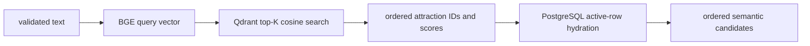

# Semantic Recommendation Engine

`SemanticAttractionRetriever.search` strips and validates the query, computes the embedding off the event loop, calls `query_points` with payload, extracts attraction IDs, hydrates only active PostgreSQL rows, and reconstructs candidates in vector-result order (`app/knowledge_base/retrieval/semantic_retriever.py:41-156`). Invalid/empty input and vector errors are controlled rather than silently fabricated.

Semantic similarity answers “does this description mean something close to the query?” Content-based recommendation additionally uses item metadata; collaborative filtering would require user-item interaction learning; a knowledge-graph recommender would traverse learned/explicit entity relations; context-aware reranking adjusts retrieved items using dated operational evidence. Component 1 implements semantic/content retrieval and context reranking, not NCF or a graph recommender.

For unified ranking, raw cosine-like scores are mapped as `clip((score+1)/2,0,1)` (`orchestrator.py:27-28`). This monotonic transformation preserves semantic order but changes the scale used in the blend. Candidate IDs are de-duplicated and limited to `UNIFIED_CONTEXT_MAX_CANDIDATES=50`. Increasing top-K can improve recall, but raises DB queries and four-layer evidence work; it does not guarantee better precision.

Failure behavior: empty retrieval returns no candidates; stale Qdrant IDs are removed during active-row hydration; duplicate IDs are removed by first occurrence; adapter failure does not fabricate context and is represented as unavailable/error evidence. A Qdrant failure prevents baseline retrieval unless candidates are supplied explicitly to the research schema; no production-grade fallback retriever was verified.

