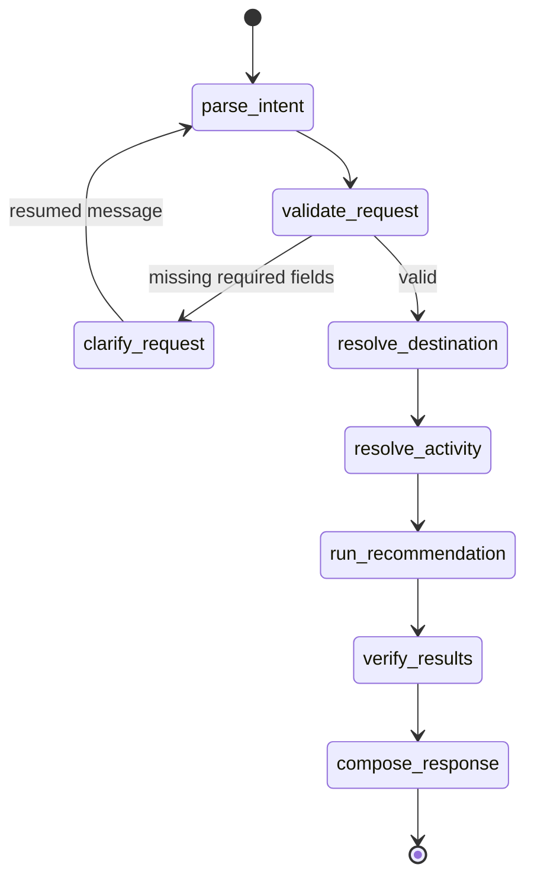

# LangGraph and LangChain Orchestration

LangGraph is now genuinely implemented. It is not a graph recommender: it is a state-machine/runtime for a multi-step request workflow.

Actual graph nodes are declared at `app/agents/recommendation_graph/builder.py:8-27`. Conditional routers decide clarification and failure paths. `langgraph.types.Command` resumes interrupted conversations. `MemorySaver` stores process-local checkpoints under an internal UUID; public session ownership is enforced using a SHA-256 owner hash and a 3,600-second sliding expiry (`checkpoint_service.py:24-61`). This storage is development-only and is lost on restart.

LangChain supplies structured tools for destination resolution, activity resolution and the existing unified recommendation service. Optional intent extraction creates `ChatOpenAI` against Groq with temperature 0, 15-second timeout and one retry only when both the feature flag and key exist (`graph_service.py:24-29`). Otherwise deterministic extraction is used. This reduces default dependency on an LLM and limits hallucination: the LLM may parse intent, but database-backed tools and verification determine results.

The API requires independent engine/API flags, a 32+ character research token and `X-Research-Owner`; production routing is prohibited; graph execution is bounded to 45 seconds (`app/routers/langgraph_recommendations.py`). The pilot processed 3 real requests/15 candidates with zero graph errors (C/B). It does not establish user satisfaction.

Why LangGraph is appropriate (D): explicit state, conditional branches, interruptions, tool traces and resumable clarification are clearer than nested direct Python. Direct Python remains simpler for a single-shot pipeline; LangGraph adds value only because this workflow has multi-turn state and verification.

